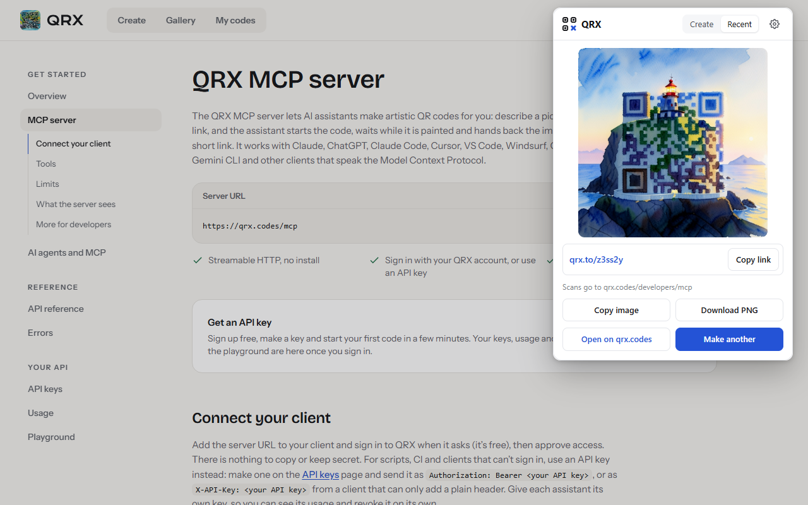

# QRX for Chrome and Edge

Make an artistic QR code for the page you're on. Click the QRX button, describe a picture, pick a style, and QRX
paints a QR code that still scans, with a hosted `qrx.to` short link. Each code is checked to scan before you get it.

The extension is a small client for the public [QRX REST API](https://qrx.codes/developers) (`https://qrx.codes/v1`).
The same package runs in Google Chrome and Microsoft Edge.



## What it does

- **Sign in with QRX.** OAuth 2.1 (authorisation code with PKCE) against QRX's sign-in service, run by the
  extension's service worker through `chrome.identity.launchWebAuthFlow`. The popup closes when the sign-in window
  opens; the worker finishes the sign-in on its own. An API key pasted on the options page also works.
- **Create.** The link is the current tab's address (read only when you click the button) and can be edited. Write a
  prompt, pick a style from `GET /v1/styles`, and press **Create QR code**.
- **Wait in the background.** Codes take about a minute. The worker saves the request with an `Idempotency-Key`, sends
  `POST /v1/codes`, then long-polls `GET /v1/codes/{id}?wait=20`. An alarm every 30 s, and a check every time the
  worker starts, resume anything left unfinished; a resent request returns the same code, never a second one. Close
  the popup and a notification tells you when the code is ready.
- **Use the code.** The popup shows the image, the short link, and **Copy link**, **Copy image**, **Download PNG** and
  **Open on qrx.codes**. **Recent** lists your codes.

## Permissions

| Permission                       | Why                                                                                                                                                           |
| -------------------------------- | ------------------------------------------------------------------------------------------------------------------------------------------------------------- |
| `activeTab`                      | Read the current tab's address when you click the QRX button, to use as the code's link. No access to any page's content, and nothing at all until you click. |
| `identity`                       | Open the QRX sign-in window (`launchWebAuthFlow`) and get its redirect back.                                                                                  |
| `storage`                        | Keep your sign-in, the codes you're waiting for, and the style you used last, in this browser.                                                                |
| `alarms`                         | Wake the background worker every 30 s while a code is being made, so a code finishes even if the browser stopped the worker.                                  |
| `notifications`                  | Tell you when a code is ready (or didn't work out).                                                                                                           |
| Host `https://qrx.codes/*`       | The QRX API and the finished images.                                                                                                                          |
| Host `https://clerk.qrx.codes/*` | QRX's sign-in service: exchanging the sign-in code for a token, and refreshing it.                                                                            |

There are no content scripts, no `<all_urls>`, no `clipboardWrite`, no `downloads`: copying and downloading happen in
the popup when you click. The dev build swaps the two hosts for `https://dev.qrx.codes/*` and
`https://*.clerk.accounts.dev/*`.

## Install from source

You need Node.js 22 or later.

```bash
git clone https://github.com/qrxcodes/qrx-chrome.git
cd qrx-chrome
npm ci
npm run build:extension        # store build, against qrx.codes -> dist/extension
# or
npm run build:extension:dev    # dev build, against dev.qrx.codes -> dist/extension-dev
```

**Chrome:** open `chrome://extensions`, turn on **Developer mode**, choose **Load unpacked** and pick
`dist/extension` (or `dist/extension-dev`).

**Edge:** open `edge://extensions`, turn on **Developer mode**, choose **Load unpacked** and pick the same folder.

Pin QRX to the toolbar, open any web page and click the QRX button.

To package for the stores: `npm run package` writes `release/qrx-extension-<version>.zip`. CI builds the same zip on
every push (see the workflow's artifacts).

## Development

```bash
npm run dev:extension   # dev build, rebuilt on every change; reload the extension in chrome://extensions
npm run lint            # ESLint + Prettier
npm run typecheck
npm test                # unit tests (Vitest)
npm run test:e2e        # loads the dev build in Playwright's Chromium (see below)
```

### Build settings

| Variable              | Default                                          | Use                                                                                                                               |
| --------------------- | ------------------------------------------------ | --------------------------------------------------------------------------------------------------------------------------------- |
| `QRX_ENV`             | `prod`                                           | `dev` builds against dev.qrx.codes and the dev sign-in service; set by the npm scripts.                                           |
| `QRX_OAUTH_CLIENT_ID` | per environment, in `build.config.ts`            | The pre-registered public OAuth client. With none, the extension registers itself on first sign-in (dynamic client registration). |
| `QRX_MANIFEST_KEY`    | dev key for dev builds, none for the store build | Fixes the extension ID. The stores assign their own IDs to the store build.                                                       |
| `EXTENSION_VERSION`   | `manifest.json`                                  | CI sets `1.0.<run number>`.                                                                                                       |

The unpacked dev build always has the ID `bcpkdmcioonkndjhpfogabejhemhahge`, so its sign-in redirect URI is
`https://bcpkdmcioonkndjhpfogabejhemhahge.chromiumapp.org/` in both Chrome and Edge. The options page shows the redirect
URI of whatever build you are running.

### End-to-end checks

`scripts/e2e.ts` loads the unpacked dev build into a fresh Chromium profile (`E2E_CHANNEL=msedge` for Edge) and checks
the fixed ID, the redirect URI, the signed-out popup, and that the sign-in window opens on the right authorisation
request. With `QRX_TEST_API_KEY_FILE` (a file holding a dev API key) it signs in with the key and checks the create
form; with `E2E_GENERATE=1` as well it makes one code, stops the service worker mid-way and checks the code still
finishes, notifies, and can be copied, downloaded and found under Recent. Signing in with a QRX account needs a person,
so the run closes the sign-in window instead.

### Store images

`npm run screenshots` captures the 1280x800 store screenshots from the real popup (store build, an API key from
`QRX_SCREENSHOT_API_KEY_FILE`, and an existing code in `QRX_SCREENSHOT_CODE_ID`; it only reads). `npm run store:assets`
renders the store icon, Edge logo, small promo tile and marquee. Everything lands in `store/assets/`.

## Privacy

The extension sends data only to QRX (`qrx.codes`, and `clerk.qrx.codes` for sign-in), and only to make and show your
codes:

- **The current tab's address**, read when you click the QRX button and sent only if you create a code, as the code's
  link. The extension never reads page content or your browsing history.
- **The prompt and style you choose**, sent to make the code, and kept in the extension's storage until the code is
  finished.
- **Your sign-in token or API key**, kept in the extension's storage in this browser and sent only to QRX to identify
  your account. Signing out removes it.

There is no analytics, advertising or tracking in the extension, and nothing is sold or shared. See the
[QRX privacy policy](https://qrx.codes/privacy) for how QRX handles your account and codes.

## Support

https://qrx.codes/support

## License

[MIT](LICENSE)
